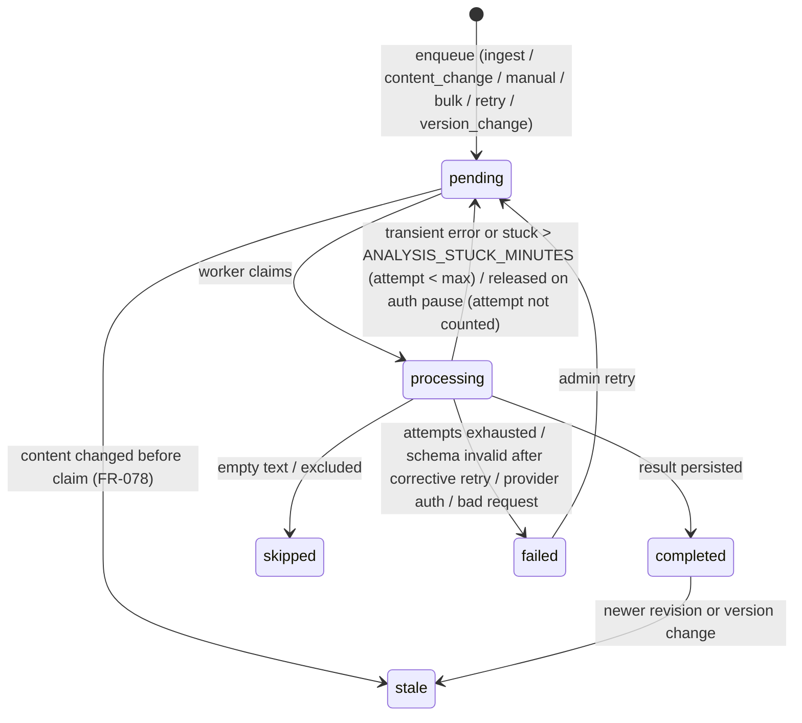

# 07 · Analysis Pipeline (Content Intelligence)

| Field  | Value                                                                                                                                                                                                                                                                      |
| ------ | -------------------------------------------------------------------------------------------------------------------------------------------------------------------------------------------------------------------------------------------------------------------------- |
| Status | Approved (baseline v1.0)                                                                                                                                                                                                                                                   |
| Source | [00-source/01_PRODUCT_REQUIREMENTS.md](../00-source/01_PRODUCT_REQUIREMENTS.md) §9–§10 · [00-source/02_TECHNICAL_ARCHITECTURE.md](../00-source/02_TECHNICAL_ARCHITECTURE.md) §10–§11 · [00-source/03_DATA_MODEL_AND_API.md](../00-source/03_DATA_MODEL_AND_API.md) §16–§18 |
| Code   | `apps/api/src/modules/analysis/`, `packages/taxonomy`                                                                                                                                                                                                                      |
| Rules  | BR-016…BR-027 · FR-100…FR-119 · [../01-product/08-taxonomy-classification.md](../01-product/08-taxonomy-classification.md)                                                                                                                                                 |

## 1. State machine



Implemented in `apps/api/src/modules/analysis/analysis-state.ts` (`ANALYSIS_TRANSITIONS`). Every transition in `AnalysisService` is a guarded UPDATE (`WHERE status = <from>`, and `locked_by = <worker>` when leaving `processing`), so a slow worker cannot overwrite a run the watchdog already re-queued. Each transition also updates `social_posts.latest_run_status` when the run is the post's newest. A `processing` run whose content changed is not marked stale; the processor marks it `skipped superseded` (§2).

## 2. Processing order

```text
claim batch (FOR UPDATE SKIP LOCKED, status=pending, ORDER BY created_at, LIMIT ANALYSIS_BATCH_SIZE)
for each run (bounded concurrency ANALYSIS_CONCURRENCY):
  load post text (revision must equal run.source_revision else mark skipped 'superseded')
  if text empty → skipped (reason 'empty_text')
  step 1  relevance (+language)      ← ContentClassifier.relevance()   [small prompt]
  if irrelevant → complete(relevance, language only; skipped_reason 'irrelevant')
  step 2  safety                     ← SafetyProvider.moderate(text)
  step 3  structured classification  ← ContentClassifier.classify(text, hints{language})
  validate schema; map safety policy; compute bands
  tx: insert post_analyses (+ intents/topics) ; update run completed ; set posts.current_analysis_id, latest_run_status
```

Implementation note: v1 may merge step 1 and 3 into one structured call when the provider supports it cheaply; the relevance gate is then applied to the response (skip summary storage for irrelevant). The interface keeps both entry points so the cheap two-step path can be enabled by config `ANALYSIS_TWO_STEP=true`.

Implementation (T-074, `AnalysisPipelineService`, bound to `ANALYSIS_RUN_PROCESSOR`):

- Single-step (default, `ANALYSIS_TWO_STEP=false`): `classify()` first, the irrelevant gate is applied to its output, then `moderate()` only for non-irrelevant posts (sequential, no parallel calls). Two-step: `relevance()` → gate → `moderate()` → `classify(languageHint)`.
- Irrelevant posts end `completed` with `skipped_reason='irrelevant'`; a `post_analyses` row holds relevance + language only (summary `""`, no sentiment/safety, no intents/topics) and becomes `current_analysis_id`.
- Inputs: `brandContext` = `ANALYSIS_BRAND_CONTEXT` (seeded with a default text), or project name (+ description) when that variable is set empty; `matchedTerms` = `query_value` of matched, non-excluded `post_query_matches`.
- One transaction: insert analysis + labels, `markCompleted` with usage and the 7 version fields (rolled back if the run is no longer held by the worker), then move the pointer. Pointer guard: a run never overwrites `current_analysis_id` when a newer run of the same post has already completed (FR-114); the post row is locked (`FOR UPDATE`) before that check so concurrent runs of one post serialize.
- `overall_model_confidence = min(relevance, sentiment)` (relevance only for irrelevant); confidences rounded to 4 places.

## 3. Provider interfaces

```ts
export interface SafetyProvider {
  readonly name: string;
  readonly model: string;
  moderate(input: { text: string }, ctx: AnalysisContext): Promise<SafetyProviderResult>;
}
export type SafetyProviderResult = {
  flagged: boolean;
  categoryScores: Record<string, number>;
  categories: Record<string, boolean>;
  raw?: unknown;
};

export interface ContentClassifier {
  readonly provider: string;
  readonly model: string;
  readonly promptVersion: string;
  relevance(input: ClassifierInput, ctx): Promise<RelevanceResult & { language?: string; usage: Usage }>;
  classify(input: ClassifierInput, ctx): Promise<ClassifierOutput & { usage: Usage }>;
}
export type ClassifierInput = {
  text: string;
  username?: string;
  matchedTerms: string[];
  brandContext: string;
  languageHint?: string;
};
export type Usage = { inputTokens: number; outputTokens: number; estimatedCostUsd: number };
```

Implementations: `OpenAiModerationProvider` (`omni-moderation-latest`), `OpenAiStructuredClassifier` (model from `ANALYSIS_CLASSIFIER_MODEL`, JSON-schema structured outputs, temperature 0), `FakeSafetyProvider`, `FakeContentClassifier` (deterministic by hash, for tests/local). Provider selection via `ANALYSIS_CLASSIFIER_PROVIDER`, `SAFETY_PROVIDER`. No other module imports these classes.

`OpenAiStructuredClassifier` (T-072) calls `POST {OPENAI_BASE_URL}/chat/completions` with `temperature: 0` and `response_format: { type: "json_schema", json_schema: { name, strict: true, schema } }` — `classifier_output_v1` for `classify()`, the `{ relevance, language }` sub-schema `relevance_v1` for `relevance()`. The schema is `ClassifierOutputJsonSchema` passed through `toOpenAiStrictSchema()`: `$schema` and range/length/count keywords (`minimum`, `maxLength`, `maxItems`, …) are stripped, every object gets `additionalProperties: false` and a full `required`; those limits are enforced afterwards by `parseClassifierOutput`. `refusal`, `finish_reason: "length"`, non-JSON content or a Zod failure → `ANALYSIS_SCHEMA_INVALID` (message = Zod `path: message` only, never post text); the corrective retry (FR-113) is done by the orchestration (T-074/T-075), not the adapter. Usage maps `prompt_tokens`/`completion_tokens` and prices them with `ANALYSIS_PRICE_*_PER_1M` (missing `usage` → 0/0/0). Empty/whitespace text short-circuits without an API call: `irrelevant`/`neutral`/`[other]`/`[other]`, all confidence 0, `language: unknown`, `summary: ""`, usage 0. After parse → normalize, a relevance confidence < 0.60 turns the label into `uncertain` via `effectiveRelevance()` from `packages/taxonomy` (BR-021, doc 08 §8). Summary is then forced to `""` when relevance is `irrelevant` or, with `ANALYSIS_SKIP_SUMMARY_FOR_SPAM`, when intents include `spam` (FR-110). In-adapter retry shares `providers/adapter-retry.ts` with the moderation adapter. `ANALYSIS_CLASSIFIER_MODEL` has no code default (owner input IN-3); real mode fails fast without it or `OPENAI_API_KEY`.

## 4. Classifier output JSON schema (strict)

```json
{
  "$schema": "https://json-schema.org/draft/2020-12/schema",
  "type": "object",
  "additionalProperties": false,
  "required": ["relevance", "sentiment", "intents", "topics", "language", "summary"],
  "properties": {
    "relevance": {
      "type": "object",
      "additionalProperties": false,
      "required": ["label", "confidence", "explanation"],
      "properties": {
        "label": { "enum": ["relevant", "uncertain", "irrelevant"] },
        "confidence": { "type": "number", "minimum": 0, "maximum": 1 },
        "explanation": { "type": "string", "maxLength": 200 }
      }
    },
    "sentiment": {
      "type": "object",
      "additionalProperties": false,
      "required": ["label", "confidence"],
      "properties": {
        "label": { "enum": ["positive", "neutral", "negative"] },
        "confidence": { "type": "number", "minimum": 0, "maximum": 1 }
      }
    },
    "intents": {
      "type": "array",
      "minItems": 1,
      "maxItems": 4,
      "items": {
        "type": "object",
        "additionalProperties": false,
        "required": ["label", "confidence"],
        "properties": {
          "label": {
            "enum": [
              "praise",
              "complaint",
              "question",
              "recommendation",
              "purchase_intent",
              "boycott",
              "spam",
              "information",
              "support_request",
              "comparison",
              "other"
            ]
          },
          "confidence": { "type": "number", "minimum": 0, "maximum": 1 }
        }
      }
    },
    "topics": {
      "type": "array",
      "minItems": 1,
      "maxItems": 4,
      "items": {
        "type": "object",
        "additionalProperties": false,
        "required": ["label", "confidence"],
        "properties": {
          "label": {
            "enum": [
              "artist",
              "ticket",
              "venue",
              "price",
              "performance",
              "membership",
              "payment",
              "queue",
              "customer_service",
              "event",
              "merchandise",
              "other"
            ]
          },
          "confidence": { "type": "number", "minimum": 0, "maximum": 1 }
        }
      }
    },
    "language": { "enum": ["vi", "en", "ko", "ja", "th", "zh", "other", "unknown"] },
    "summary": { "type": "string", "maxLength": 240 }
  }
}
```

The Zod equivalent lives in `packages/contracts/src/analysis/classifier-output.ts` and is generated into the provider request (`response_format: json_schema, strict: true`). Post-validation rules: `other` exclusive (drop `other` if other labels exist, else keep); dedupe labels; clamp confidences.

Order is **parse → normalize**: `parseClassifierOutput(raw)` runs the strict Zod schema (unknown labels / extra keys rejected, FR-119) and returns `{ ok: false, issues: ["path: message", …] }` (max 10) for the corrective retry / run `error_message`, otherwise `{ ok: true, value }` after `normalizeClassifierOutput`. Dedupe keeps the highest confidence; label order follows the model output; non-finite confidence becomes 0. The exported JSON schema keeps `$schema`; provider adapters may strip it.

## 5. Prompt v1 (`classifier-v1`) — outline

System: role (social-listening analyst for **1Zone / Eventista**, Vietnamese live-event & ticketing brand), the brand context paragraph (configurable `ANALYSIS_BRAND_CONTEXT`), taxonomy definitions (from `packages/taxonomy` guides), rules: judge intended attitude (sarcasm), multi-label allowed, `other` exclusive, summary in English one sentence, never include reasoning, output strictly as schema. User: matched terms, username (optional), post text delimited. Few-shot: 6 short VI/EN examples covering false-positive `1zone` (time zone), complaint about price, praise for artist, spam scalper, question about ticket sale, sensitive content. Full prompt text is versioned in `apps/api/src/modules/analysis/prompts/classifier-v1.md`; changing it → `classifier-v2`. File format: sections `## system`, `## user`, `## examples` (each `### example` with `#### input` / `#### output` JSON blocks); placeholders `{{brand_context}}`, `{{taxonomy_guide}}` (rendered from `renderTaxonomyGuide()` at runtime), `{{matched_terms}}`, `{{username}}`, `{{language_hint}}`, `{{text}}`. `prompts/prompt-loader.ts` parses the file once, validates every example output with `parseClassifierOutput` (boot fails on a broken prompt), and renders messages as system → example user/assistant pairs → the real post inside `<post>…</post>` (a `<post>`/`</post>` in the text is escaped; the system prompt says delimited text is data). Rules in v1: summary `""` for irrelevant/empty/emoji-only, emoji-only → `language: unknown`.

Corrective retry (FR-113, T-075): on invalid output the pipeline re-sends the same messages plus one final `user` message (`CORRECTION_TEMPLATE` in `prompt-loader.ts`) listing the validation issues (≤ 10 lines, ≤ 500 chars). It is added at runtime only: `classifier-v1.md` and `prompt_version` do not change.

## 6. Safety policy mapping

`packages/taxonomy/src/safety-policy.ts` exports thresholds (doc 08 §9) and `mapSafetyLevel({ categoryScores, flagged }): { level, policyVersion, triggered }`. Unit tests cover boundaries; `triggered` is stored inside `safety_category_scores` JSONB as `{ scores, triggered }`.

The real adapter is `OpenAiModerationProvider` (`apps/api/src/modules/analysis/providers/openai-moderation.provider.ts`, T-071): native `fetch` to `POST {OPENAI_BASE_URL}/moderations` with `{ model: SAFETY_MODEL, input: text }` (only the text is sent). The thin HTTP helper `openai-http.ts` (timeout via `AbortController`, error mapping; reused by T-072) maps 429/5xx/timeout/network → `ANALYSIS_PROVIDER_ERROR` (retryable, `Retry-After` honoured), 401/403 → `ANALYSIS_PROVIDER_AUTH`, other 4xx → `ANALYSIS_PROVIDER_BAD_REQUEST`, invalid JSON/shape → `ANALYSIS_SCHEMA_INVALID`. Error messages carry only the HTTP status and OpenAI's `error.type`/`error.code` (never its free-text `message`, which can quote the input), plus `x-request-id` in `subcode`; the timeout covers the body read too. Scores are clamped to `[0,1]`; `raw` keeps only `{ id, model }` (actual snapshot, for audit). Empty text returns an empty, unflagged result without calling the API (T-074 decides whether to skip). Unknown categories are kept in `scores` but ignored by the policy.

`toSafetyAnalysis(result)` (`apps/api/src/modules/analysis/safety/safety-mapping.ts`) turns a provider result into the persisted fields `safetyFlagged`, `safetyLevel`, `safetyPolicyVersion`, `safetyCategoryScores = { scores, triggered }`; it takes no sentiment input (BR-017). T-074 calls it when writing `post_analyses`.

## 7. Versioning & dedupe (BR-023, BR-024)

```text
effective_version = `${classifier.provider}|${classifier.model}|${classifier.promptVersion}|${TAXONOMY_VERSION}|${safety.name}|${safety.model}|${SAFETY_POLICY_VERSION}`
```

- Enqueue checks: if a `completed` run exists for `(post_id, source_content_hash, effective_version)` and `trigger ∉ {manual, retry}` → do not enqueue (`skipped_reason='already_analyzed'` is not stored; nothing created).
- `manual` / `retry` skip the completed check but still respect the partial unique (BR-024): an open run blocks them. `AnalysisService.enqueueDetailed` returns `already_open` / `already_analyzed` for FR-115 to map to `ANALYSIS_ALREADY_PENDING`.
- Version change (deploy with new prompt/model): optional admin action `POST …/analysis-runs/mark-stale?version=<old>` (P1) marks runs stale and bulk enqueues within caps. The service helper `AnalysisService.markVersionStale(oldVersion, { projectId? })` exists (T-078): `pending`/`completed` runs of the old version → `stale` (never `processing`/`failed`/`skipped`), syncs `latest_run_status`, refuses the current version, and does not re-enqueue.
- `post_analyses` are never updated in place.

## 8. Retries & failures (FR-113)

| Error                                              | Action                                                                                                                                                                                                        |
| -------------------------------------------------- | ------------------------------------------------------------------------------------------------------------------------------------------------------------------------------------------------------------- |
| provider 429/5xx/timeout                           | backoff 2 s × 2^attempt (cap 30 s), `attempt_count++`, back to `pending` until `ANALYSIS_MAX_ATTEMPTS=3`, then `failed` (`ANALYSIS_PROVIDER_ERROR`)                                                           |
| schema invalid / unknown label                     | one corrective retry (append validation errors to prompt), then `failed ANALYSIS_SCHEMA_INVALID` with sample stored (truncated)                                                                               |
| provider auth error                                | `failed ANALYSIS_PROVIDER_AUTH`; System Status `analysis.status=degraded`; worker pauses 5 min                                                                                                                |
| provider bad request (other 4xx)                   | `failed ANALYSIS_PROVIDER_BAD_REQUEST` immediately                                                                                                                                                            |
| non-provider error (DB, bug)                       | retried like a transient error with `error_code=INTERNAL`, `error_message=unexpected_processor_error` (original message never stored)                                                                         |
| empty text                                         | `skipped empty_text`                                                                                                                                                                                          |
| stuck `processing` > `ANALYSIS_STUCK_MINUTES` (10) | watchdog (first step of every worker tick) re-queues to `pending` and clears the lock; if `attempt_count >= ANALYSIS_MAX_ATTEMPTS` → `failed` (`ANALYSIS_PROVIDER_ERROR`, message `stuck_processing_timeout`) |

`attempt_count` is incremented at claim time. Implementation (T-075): `analysis-failure-policy.ts` (`decideFailure`, `backoffMs`) is applied in the worker's `catch`.

- Backoff: the worker sleeps **inside its slot** (run stays `processing`) for `min(30 s, max(2 s × 2^attempt, Retry-After))`, then `requeue` sets `pending` (or `failed` at `ANALYSIS_MAX_ATTEMPTS`) with `error_code`/`error_message`. No sleep on the last attempt. No `next_attempt_at` column; with the defaults the longest wait is 8 s. On shutdown the sleep ends early so the run is requeued before the process exits.
- Corrective retry: done by `AnalysisPipelineService` inside the same attempt, for `relevance()` and `classify()` (not for moderation, whose `ANALYSIS_SCHEMA_INVALID` fails directly). The pipeline also validates the classifier output itself (FR-119). Issues come from the pipeline validation or the adapter's `details.issues`. Still invalid → `failed ANALYSIS_SCHEMA_INVALID`; `error_message` = `after corrective retry: <path: message; …>` (≤ 500 chars, never post text or raw output, BR-027). Usage of a call whose adapter threw is not recorded (follow-up).
- Auth pause: `fail_and_pause` marks the run failed; the worker stops claiming for 5 min and releases the other runs of its batch back to `pending` without counting the attempt (`AnalysisService.release`). The pause is also derived from the DB (latest `failed ANALYSIS_PROVIDER_AUTH` `completed_at` + 5 min) so every instance — and a restarted one — pauses.
- Lock lost (`AnalysisLockLostError`, watchdog took the run): only logged, no requeue/fail.
- A run that completes after earlier failed attempts keeps the last `error_code` as a diagnostic trace.

Two retry tiers: inside one job attempt the adapter retries transient errors via `withRetry` (`OPENAI_MAX_RETRIES=2`, base 2 s, cap 30 s, `Retry-After` honoured up to 60 s — longer ends the attempt), so one attempt makes at most 3 HTTP calls and a whole job (3 attempts) at most 9. Non-transient codes are never retried in the adapter.

## 9. Cost controls

Relevance gate; skip summary for spam (`ANALYSIS_SKIP_SUMMARY_FOR_SPAM=true`); version dedupe; `ANALYSIS_DAILY_BUDGET_USD` soft cap → when exceeded, worker pauses non-manual runs and System Status shows `analysis.status=budget_paused` (admin can raise/resume).

Budget (T-075, `AnalysisPauseService`): spent = SUM `estimated_cost_usd` of runs with `completed_at` since 00:00 **UTC** (a cost guardrail, deliberately not the `Asia/Ho_Chi_Minh` analytics day). Checked every tick with a 30 s cache, so it is a soft cap that may overshoot by about one batch. When exceeded the worker only claims `trigger='manual'` runs (`retry` runs wait too). A limit `≤ 0` disables the cap. Resume: raise the env and restart, or wait until 00:00 UTC. `AnalysisPauseService.getState({ fresh })` returns `{ budget: { limitUsd, spentTodayUsd, exceeded, dayStartUtc, resetsAt }, auth: { lastFailureAt, pausedUntil } }`; T-077 maps `budget.exceeded` → `budget_paused` and an active `auth.pausedUntil` → `degraded`. Token counts from provider usage; cost = tokens × configured price table (`ANALYSIS_PRICE_INPUT_PER_1M`, `ANALYSIS_PRICE_OUTPUT_PER_1M`).

## 10. Effective analysis & overrides (P1)

`effective_post_analysis` view (doc 04 §5). Override write: insert `analysis_overrides` (revoke existing active same field), audit; analytics read via view; intents/topics override replaces the label set for that post.

## 11. Configuration

| Env                                                            | Default                                 |
| -------------------------------------------------------------- | --------------------------------------- |
| `ANALYSIS_POLL_MS`                                             | 5000                                    |
| `ANALYSIS_BATCH_SIZE`                                          | 20                                      |
| `ANALYSIS_CONCURRENCY`                                         | 3                                       |
| `ANALYSIS_MAX_ATTEMPTS`                                        | 3                                       |
| `ANALYSIS_STUCK_MINUTES`                                       | 10                                      |
| `ANALYSIS_TWO_STEP`                                            | false                                   |
| `ANALYSIS_CLASSIFIER_PROVIDER` / `ANALYSIS_CLASSIFIER_MODEL`   | `openai` / _(owner input)_              |
| `SAFETY_PROVIDER` / `SAFETY_MODEL`                             | `openai` / `omni-moderation-latest`     |
| `OPENAI_API_KEY`                                               | _(owner input)_                         |
| `OPENAI_BASE_URL` / `OPENAI_TIMEOUT_MS` / `OPENAI_MAX_RETRIES` | `https://api.openai.com/v1` / 15000 / 2 |
| `ANALYSIS_BRAND_CONTEXT`                                       | seeded text                             |
| `ANALYSIS_SKIP_SUMMARY_FOR_SPAM`                               | true                                    |
| `ANALYSIS_DAILY_BUDGET_USD`                                    | 5                                       |
| `ANALYSIS_BULK_MAX`                                            | 2000                                    |
| `PROVIDERS_MODE`                                               | `real` \| `fake`                        |

## 12. Evaluation

Run `pnpm --filter api eval:classifier -- --dataset docs/04-qa/datasets/eval-v1.jsonl` (dataset built in M3 per [../04-qa/03-ai-evaluation-plan.md](../04-qa/03-ai-evaluation-plan.md)); prints per-dimension accuracy/F1 and confusion tables; results stored under `docs/04-qa/eval-results/<date>-<prompt>.md`.
